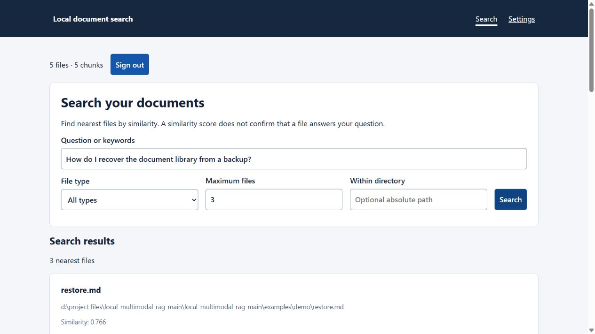
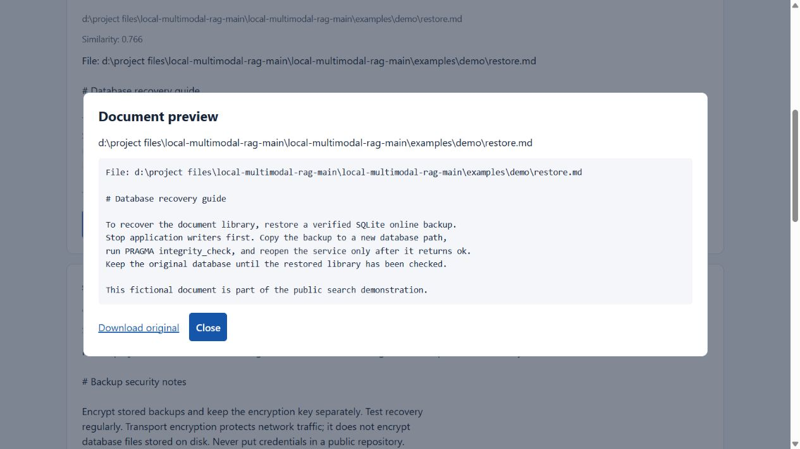

# Local Multimodal RAG

Local file indexing and semantic document search through a CLI and a small browser interface. The application scans only explicitly selected folders, extracts text, requests embeddings from a separately managed local service, and searches a versioned SQLite index.

Text, code, PDF, Office and ebook readers are supported. OCR, audio transcription, vision descriptions and legacy converters are optional profiles. Results are nearest files with snippets and source inspection; the application does not generate answers or calibrated confidence scores.

## Working demonstration

Real browser captures from the application, using the pinned local Nomic embedding model and the five fictional files in [examples/demo](examples/demo). The recovery question retrieves `restore.md` first; inspecting it opens the indexed source text. These are working UI captures, not mockups. This small text/code example demonstrates retrieval and source inspection; it does not evaluate the optional OCR, audio or vision profiles, or establish benchmark accuracy.





After completing the runtime and model-service setup below, run this from the project root. The demo profile selects only the included sample folder and stores its database under the ignored `.verification/demo/` directory.

```powershell
.\.venv\patched\Scripts\python.exe run_pipeline.py --config config.demo.example.yaml init-db
.\.venv\patched\Scripts\python.exe run_pipeline.py --config config.demo.example.yaml scan
.\.venv\patched\Scripts\python.exe run_pipeline.py --config config.demo.example.yaml extract-meta
.\.venv\patched\Scripts\python.exe run_pipeline.py --config config.demo.example.yaml process
.\.venv\patched\Scripts\python.exe run_pipeline.py --config config.demo.example.yaml search "How do I recover the document library from a backup?" --top-k 3
.\.venv\patched\Scripts\python.exe run_pipeline.py --config config.demo.example.yaml serve
```

Open `http://127.0.0.1:8100/`, sign in with the token from `.verification/demo/.api_token`, and ask the same question with **Maximum files** set to **3**. Select **Inspect document** on `restore.md`. To print the token locally, use `run_pipeline.py --config config.demo.example.yaml token` with the same Python interpreter. The captures use isolated local ports; paths and scores can differ on another machine. No API token, demo database, model weights or private document is included in this repository.

## Setup

Use the checksum-pinned Python distribution in `PYTHON_DISTRIBUTIONS.json`. The runtime gate requires a SQLite build containing the documented WAL fix. Full Windows/Linux provisioning details are in [runtime setup](docs/PROJECT_RUNTIME.md).

On a fresh Windows checkout, from the directory containing `run_pipeline.py`:

```powershell
python tools/provision_runtime.py --destination .runtime/python-3.13.18 --output .verification/distribution.json
.\.runtime\python-3.13.18\python\python.exe -m venv .venv/patched
.\.venv\patched\Scripts\python.exe -m pip install -r requirements.lock
.\.venv\patched\Scripts\python.exe tools/verify_runtime.py --output .verification/runtime.json
.\.venv\patched\Scripts\python.exe -m pip check
```

Skip provisioning an already verified local distribution; the provisioner refuses to overwrite an existing destination. `requirements.txt` is the smaller core; `requirements-formats.txt` adds parsers; `requirements-dev.txt` adds tests. Inference engines and model weights are not installed by those commands.

Provision a compatible local model service using [service setup](docs/SERVICE_SETUP.md) and the pinned model manifests. For the Nomic profile, copy `config.ollama.example.yaml` to `my-config.yaml`, set `scanner.scan_paths` to your intended folders and choose a database path. Relative paths resolve beside that YAML file. No personal folder is selected by default; no model is downloaded automatically.

```powershell
.\.venv\patched\Scripts\python.exe run_pipeline.py --config my-config.yaml init-db
.\.venv\patched\Scripts\python.exe run_pipeline.py --config my-config.yaml scan
.\.venv\patched\Scripts\python.exe run_pipeline.py --config my-config.yaml extract-meta
.\.venv\patched\Scripts\python.exe run_pipeline.py --config my-config.yaml process --limit 20
.\.venv\patched\Scripts\python.exe run_pipeline.py --config my-config.yaml search "recover the database" --top-k 10
.\.venv\patched\Scripts\python.exe run_pipeline.py --config my-config.yaml serve
```

Open `http://127.0.0.1:8100/`. Sign in with the private `.api_token` beside the selected database; `token` is a CLI subcommand for reading it locally. Settings are at `/config`. Keep working profiles, credentials, databases and backups private. Changing files requires another scan and processing pass.

## Local services and safety

The application owns its jobs and clients, not externally started inference services. Local-only policy rejects non-loopback endpoints before transmission; cloud access requires explicit policy and endpoint opt-in. Authentication, host/origin checks, inert text rendering and source-identity checks apply to the browser and API. Explicit roots and filesystem checks do not constitute an OS sandbox for hostile document parsers.

For the pinned Jina TEI profile, keep application batch size1 and service client-batch/concurrency caps1: the backend has a known batch/concurrency semantic defect. Do not relax those caps without new semantic verification. See [Jina deployment](docs/JINA_DEPLOYMENT.md).

OCR-enabled PDF pages containing raster images preserve native text and append bounded page OCR. This includes native headers with scanned bodies. OCR-disabled raster content is omitted and flagged in metadata. After an extractor update, back up and process again to refresh older extraction; complex layouts and OCR accuracy remain limited.

Before an incompatible embedding rebuild, take an online backup and follow [offline setup and recovery](docs/RECOVERY_AND_OFFLINE.md). Rebuilds are not atomic index swaps and do not automatically roll back.

## Development and verification

Install a supported Node22 runtime for the dependency-free browser behavior tests. From the project root:

```powershell
.\.venv\patched\Scripts\python.exe -m pytest -q
node --test tests/browser_intent.test.cjs
node --check static/app.js
```

The workflow in `.github/workflows/tests.yml` provisions the pinned Python and runs the Python/JavaScript checks. Its presence does not attest a hosted run. Optional acceptance tools generate their own controlled fixtures; write their output under the ignored `.verification/` directory. Actual inference requires separately provisioned local assets.

## Documentation

- [Architecture](docs/ARCHITECTURE.md) and [API contracts](docs/API_CONTRACTS.md).
- [Model card and evaluation limits](MODEL_CARD.md) and [known limitations](docs/KNOWN_LIMITATIONS.md).
- [Configuration compatibility](docs/CONFIGURATION_COMPATIBILITY.md), [format capabilities](docs/FORMAT_CAPABILITIES.md), [corpus policy](docs/CORPUS_POLICY.md), and [job lifecycle](docs/JOB_LIFECYCLE.md).
- [OCR](docs/OCR_DEPLOYMENT.md), [audio](docs/AUDIO_DEPLOYMENT.md), [vision](docs/VISION_DEPLOYMENT.md), and [legacy formats](docs/LEGACY_DEPLOYMENT.md).
- [Performance checks](docs/PERFORMANCE_PROFILE.md), [license](LICENSE), [third-party notices](THIRD_PARTY_NOTICES.md), and [publication sanitization](SANITIZATION_REPORT.md).

This is a local engineering pilot. Broad production quality, accessibility across physical devices, calibrated unknown detection and generated answers are not certified. Historical internal audit/benchmark records and local assets are deliberately excluded from the public source release. See the model card for the boundaries of reported measurements.
